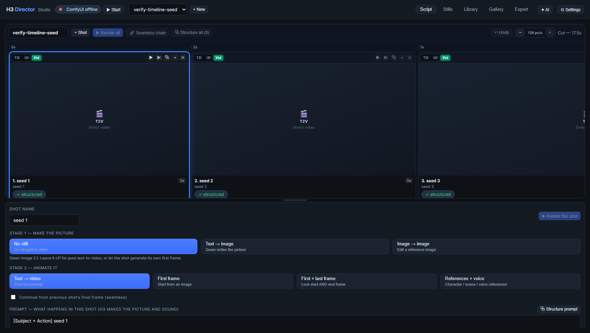

# H3 Director Studio

A local director's desk for **MiniMax H3** video generation.

H3 Director Studio gives you a real shot timeline - first/last frames, character and voice
references, take management and seamless long-video chaining - while your existing
**ComfyUI** installation stays headless in the background as the render engine. You work
like an editor, not like someone assembling node graphs by hand.



> Independent open-source project. Not affiliated with MiniMax, Alibaba/Qwen or ComfyUI.
> The repository contains **no model weights**. Model downloads are governed by their own licenses.

---

## Why this exists

ComfyUI is an excellent engine, but a node canvas is a poor editing surface for a film.
A director thinks in shots, takes, continuity and exports. This project keeps ComfyUI
as the engine and adds the layer that was missing:

- a **timeline** where each shot has its own mode and parameters;
- a **Library** of characters, places, motion clips and voices with roles and tags;
- a **two-stage shot pipeline**: generate a still with Qwen Image 2.1, then animate it with H3;
- **exact seams** between shots by conforming the previous shot's final frame into the next one;
- a **render queue**, per-shot takes, accept/reject, and a one-click H.264/AAC export;
- an optional **AI co-director** that turns a logline into a structured shot list.

Everything runs locally. No account, telemetry or cloud service is required for the core app.

---

## Features

| Area | What you get |
| --- | --- |
| **Timeline** | Add, duplicate, split, reorder and resize shots. Shift-click a range for batch chain / render / delete. Ctrl+Z undoes structural changes. |
| **Shot modes** | `t2v` text-to-video, `i2v` first-frame image, `fl2v` first **and** last frame locked, `r2v` character / location / voice references. |
| **Still stage** | Per shot: `none`, `t2i` (Qwen writes the picture) or `i2i` (Qwen edits Library references). Up to 4 variants, random or fixed seeds, its own take list. |
| **References** | Content-hashed staging into `ComfyUI/input/h3director/`; up to 9 images, 3 videos and 3 audio references per shot. Drag an image from Explorer straight onto a shot tile. |
| **Seamless chain** | "Continue from previous shot" extracts the exact previous last frame and conforms it as the next clip's first frame. Measured seams: PSNR about 37 dB. |
| **Queue** | Serial render queue with live WebSocket updates, per-shot re-render, cancel, durable JSONL job logs and saved compiled graphs. |
| **Gallery & export** | Accept the best take of each shot, inspect its seed and exact prompt, then concatenate accepted takes into one MP4 with ffmpeg. |
| **AI co-director** | Any OpenAI-compatible endpoint - Ollama, LM Studio, OpenAI, Gemini, Grok, OpenRouter, OpenCode, KiloCode, Cline or a custom URL - writes the shot list. |
| **Windows autostart** | Optional per-user Startup shortcut plus supervisor that starts the backend, watches it and restarts it if it crashes. |

---

## Architecture at a glance

```text
 Browser (React + Vite)
        |  REST + /ws
        v
 Express backend (Node/TypeScript)
   |        |        |         |
   |        |        |         +-- AI co-director (OpenAI-compatible)
   |        |        +------------ ffmpeg: frames, conform, concat, export
   |        +--------------------- durable JSON store under data/
   +------------------------------ ComfyUI REST/WebSocket client
                                      |
                                      v
                         ComfyUI (headless render engine)
                    MiniMax H3 Easy nodes + Qwen Image 2.1
```

The browser never talks to ComfyUI directly. The backend compiles each shot into an
API-format ComfyUI prompt, stages media, submits the job, polls the result, pulls the
video back over `/view` and files it under `data/outputs/`.

See [docs/ARCHITECTURE.md](docs/ARCHITECTURE.md) for the full pipeline, including why
the first frame has to be conformed in post.

---

## Quick start

### Prerequisites

- Windows 10/11 (the launcher is Windows-oriented; the Node server itself is portable).
- **Node.js 20 or newer**.
- A working **ComfyUI** install with the MiniMax H3 and Qwen Image models already downloaded.
- **ffmpeg** and **ffprobe** on `PATH`.

### Install and run

```bash
git clone https://github.com/MassimoJJ/h3-director.git
cd h3-director
npm install
npm run build
npm start
```

Open **http://127.0.0.1:8788**. On Windows you can also double-click `start.bat`; it
installs dependencies, builds the UI if needed and starts the supervised launcher.

The app auto-discovers a running portable ComfyUI install. If that fails, open
**Settings**, paste the absolute ComfyUI folder and press **Refresh probe**. The status
panel lists missing nodes and missing model files instead of failing silently later.

Full walkthrough: [docs/INSTALLATION.md](docs/INSTALLATION.md).

> ComfyUI itself is **not** started on every boot. It takes minutes to load models and
> occupies most of the VRAM. Start it with the **Start** button in the top bar, with
> `run_nvidia_gpu.bat`, or add `-WithComfy` to the launcher if you really want it at logon.

---

## What needs to be downloaded

The app ships no weights. A working install needs:

| Component | Where to get it | Why |
| --- | --- | --- |
| Node.js 20+ | https://nodejs.org/ | Runs the backend and builds the UI |
| ComfyUI portable | https://github.com/comfyanonymous/ComfyUI/releases | The render engine |
| `ComfyUI-MiniMaxH3-Easy` | https://github.com/nkxx188/ComfyUI-MiniMaxH3-Easy | H3 loader / easy nodes used by the compiled graph |
| MiniMax H3 model files | [Comfy-Org/MiniMax-H3](https://huggingface.co/Comfy-Org/MiniMax-H3) | FL2VA and Ref2VA transformers, Qwen3-VL text encoder, video + audio VAE |
| Qwen Image 2.1 files | [Comfy-Org/Qwen-Image-2.1](https://huggingface.co/Comfy-Org/Qwen-Image-2.1) | The optional but normal still stage |
| ffmpeg / ffprobe | https://ffmpeg.org/download.html | Frame extraction, exact seam conforming, MP4 export |
| Local LLM (optional) | Ollama or LM Studio | AI co-director without an API key |

Exact filenames, target folders and CLI download commands are in
[docs/INSTALLATION.md](docs/INSTALLATION.md#step-4---download-the-model-files).

---

## First render in five minutes

1. Start ComfyUI (`run_nvidia_gpu.bat`) and wait until `http://127.0.0.1:8188` answers.
2. Start H3 Director (`npm start` or `start.bat`) and open `http://127.0.0.1:8788`.
3. In **Settings**, check the probe: ComfyUI up, required nodes present, models listed.
4. On the **Script** tab, add a shot. Write a prompt: subject, action, environment,
   camera and sound. Choose a mode and duration (0.5-15 s).
5. Press **Render**. Watch progress in the top bar and open the take in **Gallery**.
6. Accept the take, then press **Export** to write one MP4 with every accepted shot.

For a longer film, add several shots and use **Seamless chain** so shot N+1 starts from
the exact final frame of shot N. Long films are several shots by design: H3 cannot
generate more than 15 seconds in one pass.

More recipes and prompt guidance: [docs/WORKFLOWS.md](docs/WORKFLOWS.md).

---

## The two-stage shot pipeline

Every shot can run as two stages:

```text
 [Stage 1] Qwen Image 2.1 still
     none | t2i (text to image) | i2i (edit Library references)
                         |
                         v
              promoted to Library, used as first frame
                         |
 [Stage 2] MiniMax H3 video
     t2v | i2v | fl2v | r2v  ->  MP4 take with audio
```

Rendering a **still** only runs stage 1 and promotes the chosen take to the shot's
first frame. Rendering the **shot** runs both stages, so the still made in that run is
the real first frame. Older projects without a still block load unchanged as `none`.

The separate **Stills** tab is a look-development scratchpad. It does not automatically
feed shots; promote a still to the Library and attach it if you want to use it.

---

## Repository layout

```text
backend/                 Express API, ComfyUI client, render engine, queue, ffmpeg
  src/app.ts             HTTP routes and status probe
  src/engine.ts          builds the H3 API-format graph
  src/qwen.ts            builds the Qwen Image 2.1 graph
  src/queue.ts           serial render/image queue, chaining, export
  src/store.ts           atomic JSON persistence and backup recovery
  src/settings.ts        settings, data dirs, durable job logs
  src/providers.ts       AI provider catalog
web/                     React + Vite single-page UI
scripts/                 Windows launcher, autostart installer, regression harnesses
docs/                    Installation, architecture, workflows, API, verification, troubleshooting
data/                    Runtime state - created on first start, git-ignored
```

---

## Verification

```bash
npm run verify          # typecheck + web build + data-safety regressions
npm run verify:store    # fast store regressions, no server needed
npm run verify:timeline # timeline geometry and drag/reorder in a real browser
```

`verify:store` uses a temporary data directory and never touches real projects.
`verify:timeline` needs the app running; it creates and removes a throwaway project if
the open one has fewer than two shots.

Details: [docs/VERIFICATION.md](docs/VERIFICATION.md).

---

## Documentation

| Document | What it covers |
| --- | --- |
| [Installation](docs/INSTALLATION.md) | Every download, exact model folders, first launch, optional autostart |
| [Architecture](docs/ARCHITECTURE.md) | Graph construction, staging, seams, queue, persistence, key handling |
| [Workflows](docs/WORKFLOWS.md) | Timeline editing, shot modes, chaining, takes, export, co-director |
| [API](docs/API.md) | REST endpoints and WebSocket events for scripts and integrations |
| [Verification](docs/VERIFICATION.md) | Test harnesses and what each one proves |
| [Troubleshooting](docs/TROUBLESHOOTING.md) | Common failures and what to check |
| [Task history](TASK_HISTORY.md) | Original development and verification log |

---

## Performance

Measured on an RTX 4090 (24 GB), roughly **1.5-4 minutes per shot** depending on
resolution and step count: 360-480p at 16-20 steps is around 60-120 s, 768p/2K can
take 4-5 minutes. Use low resolution and fewer steps for drafts, then re-render finals.

---

## Contributing and license

Contributions are welcome. See [CONTRIBUTING.md](CONTRIBUTING.md).

The **code** in this repository is MIT licensed - see [LICENSE](LICENSE). The MiniMax H3
weights are under the [MiniMax H3 Community License](https://huggingface.co/MiniMaxAI/MiniMax-H3/blob/main/LICENSE),
and Qwen Image 2.1 weights under the [Qwen Research License](https://huggingface.co/Qwen/Qwen-Image-2.1/blob/main/LICENSE).
Those licenses are not changed by this repository. Optional LoRAs, node packs and models
keep their own licenses too.
