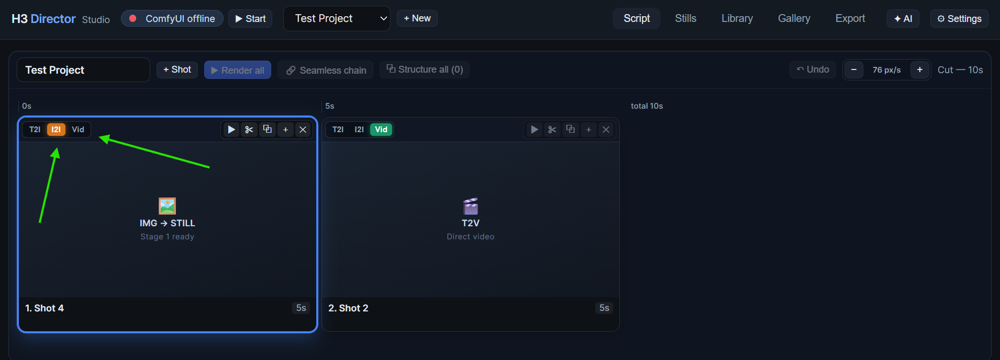
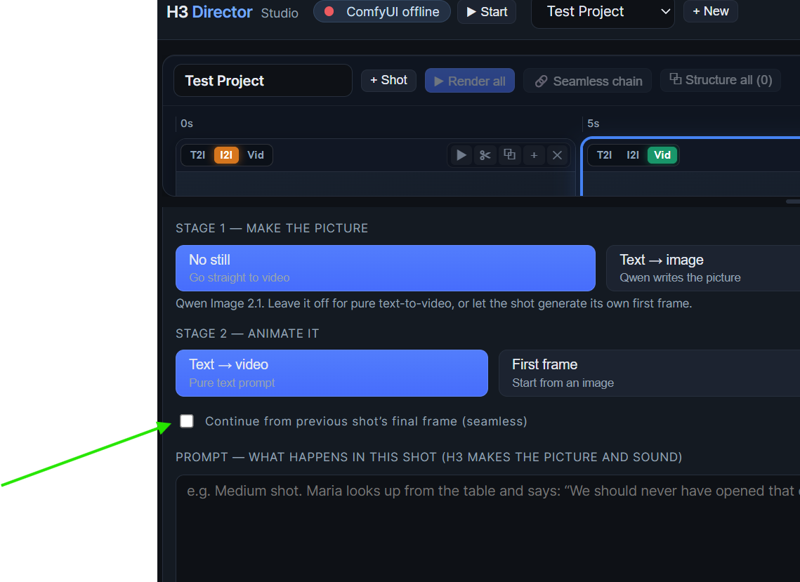

# H3 Director Studio

A local director's desk for **MiniMax H3** image **and** video generation.

H3 Director Studio is a complete local studio around your existing ComfyUI install. In
one shot you can:

- generate the picture with **Qwen Image 2.1** using **text -> image** or
  **image -> image** editing of Library references;
- animate it with **H3** as text-to-video, first-frame, first+last-frame, or with
  character / location / voice references;
- tick **Continue from previous shot's final frame (seamless)** so the next clip starts
  from an exact copy of the previous shot's last frame.

You generate stills, keep the takes you like, promote them into the Library, reuse them
as first frames or references, then render video with synchronized audio and export the
accepted takes as one film. ComfyUI stays headless in the background as the render
engine. You work like an editor, not like someone assembling node graphs by hand.





> Independent open-source project. Not affiliated with MiniMax, Alibaba/Qwen or ComfyUI.
> The repository contains **no model weights**. Model downloads are governed by their own licenses.

---

## What it solves

ComfyUI is an excellent engine, but a node canvas is a poor editing surface for a film.
A director thinks in shots, takes, continuity and exports. H3 Director keeps ComfyUI as
the engine and adds the layer that was missing:

1. **Two models, one shot.** Image generation and video generation are not separate
   projects. Stage 1 creates or edits the picture with Qwen Image 2.1
   (`text -> image` or `image -> image`); Stage 2 animates that exact picture with H3.
   You can also skip Stage 1 and go straight to video.
2. **A real timeline.** Shots can be reordered, resized, duplicated, split, selected as
   a range and chained. Each shot carries its own mode, prompt, duration, seed,
   sampler, references and still-stage settings.
3. **Long films despite a 15-second ceiling.** H3 cannot render more than 15 seconds in
   one pass. The app splits a film into shots and, when
   **Continue from previous shot's final frame (seamless)** is enabled, overwrites the
   next clip's first frame with the previous clip's exact last frame. The cut is
   frame-identical, not merely a similar-looking prompt continuation.
4. **Character identity lock.** A source portrait is bound to the project or to a
   shot and is attached to *both* stages. Qwen receives it as a still reference; H3
   receives it as `<Picture 1>` in reference mode, ahead of the seam frame and your
   other references. A head turn, a reverse angle or a new shot no longer means a new
   face. Existing `<Picture N>` tags are renumbered automatically.
5. **Takes instead of throwaway renders.** Every still and video render becomes a take
   with its seed, prompt, graph and log. Compare variants, promote the best image to
   the Library, accept the best video, and export only accepted takes.
6. **Real references and voice.** Characters, locations, motion clips and voices live
   in a tagged Library. Reference files are content-hashed and staged into ComfyUI, so
   `<Picture N>`, `<Video N>` and `<Audio N>` always point at the bytes you intended.
7. **Reproducibility and safety.** The exact graph sent to ComfyUI is saved beside the
   take, every job has a JSONL log, projects are written atomically with backups, and
   the whole runtime `data/` directory stays out of git.

Everything runs locally. No account, telemetry or cloud service is required for the core app.

---

## Features

| Area | What you get |
| --- | --- |
| **Timeline** | Add, duplicate, split, reorder and resize shots. Shift-click a range for batch chain / render / delete. Ctrl+Z undoes structural changes. |
| **Still / image generation** | Stage 1 per shot: `none`, `t2i` **text-to-image** (Qwen writes the picture) or `i2i` **image-to-image** (Qwen edits Library references). Up to 4 variants, random or fixed seeds, its own take list. |
| **Video generation** | Stage 2: `t2v` text-to-video, `i2v` first-frame image, `fl2v` first **and** last frame locked, `r2v` character / location / voice references. H3 writes picture and sound in one pass. |
| **Character lock** | One source portrait per project or shot. Attached to Qwen stills and to H3 as an identity-only reference: behind the seam frame as `<Picture 2>` when continuing (the seam is `<Picture 1>`, written back to frame 0, and its location/camera are locked for the whole shot), otherwise as `<Picture 1>`. Existing picture tags are shifted. Attaching it switches stage 2 to reference mode. |
| **References** | Content-hashed staging into `ComfyUI/input/h3director/`; up to 9 images, 3 videos and 3 audio references per shot. A chained identity-locked shot reserves one video slot for the previous clip. Drag an image from Explorer straight onto a shot tile. |
| **Seamless chain** | The checkbox **Continue from previous shot's final frame (seamless)** writes the exact previous last frame as the next clip's frame 0, then dissolves straight into moving generated footage — no frozen hold, no jump. Frame rate and audio are preserved. |
| **Queue** | Serial render queue with live WebSocket updates, per-shot re-render, cancel, durable JSONL job logs and saved compiled graphs. |
| **Gallery & export** | Accept the best take of each shot, inspect its seed and exact prompt, then concatenate accepted takes into one MP4 with ffmpeg. |
| **AI co-director** | Any OpenAI-compatible endpoint - Ollama, LM Studio, OpenAI, Gemini, Grok, OpenRouter, OpenCode, KiloCode, Cline or a custom URL - writes the shot list. |
| **Windows autostart** | Optional per-user Startup shortcut plus supervisor that starts the backend, watches it and restarts it if it crashes. |

---

## Architecture at a glance

```text
 Browser (React + Vite)
        |  REST + /ws
        v
 Express backend (Node/TypeScript)
   |        |        |         |
   |        |        |         +-- AI co-director (OpenAI-compatible)
   |        |        +------------ ffmpeg: frames, conform, concat, export
   |        +--------------------- durable JSON store under data/
   +------------------------------ ComfyUI REST/WebSocket client
                                      |
                                      v
                         ComfyUI (headless render engine)
                    MiniMax H3 Easy nodes + Qwen Image 2.1
```

The browser never talks to ComfyUI directly. The backend compiles each shot into an
API-format ComfyUI prompt, stages media, submits the job, polls the result, pulls the
video back over `/view` and files it under `data/outputs/`.

See [docs/ARCHITECTURE.md](docs/ARCHITECTURE.md) for the full pipeline, including why
the first frame has to be conformed in post.

---

## Quick start

### Prerequisites

- Windows 10/11 (the launcher is Windows-oriented; the Node server itself is portable).
- **Node.js 20 or newer**.
- A working **ComfyUI** install with the MiniMax H3 and Qwen Image models already downloaded.
- **ffmpeg** and **ffprobe** on `PATH`.

### Install and run

```bash
git clone https://github.com/MassimoJJ/h3-director.git
cd h3-director
npm install
npm run build
npm start
```

Open **http://127.0.0.1:8788**. On Windows you can also double-click `start.bat`; it
installs dependencies, builds the UI if needed and starts the supervised launcher.

The app auto-discovers a running portable ComfyUI install. If that fails, open
**Settings**, paste the absolute ComfyUI folder and press **Refresh probe**. The status
panel lists missing nodes and missing model files instead of failing silently later.

Full walkthrough: [docs/INSTALLATION.md](docs/INSTALLATION.md).

> ComfyUI itself is **not** started on every boot. It takes minutes to load models and
> occupies most of the VRAM. Start it with the **Start** button in the top bar, with
> `run_nvidia_gpu.bat`, or add `-WithComfy` to the launcher if you really want it at logon.

---

## What needs to be downloaded

The app ships no weights. A working install needs:

| Component | Where to get it | Why |
| --- | --- | --- |
| Node.js 20+ | https://nodejs.org/ | Runs the backend and builds the UI |
| ComfyUI portable | https://github.com/comfyanonymous/ComfyUI/releases | The render engine |
| `ComfyUI-MiniMaxH3-Easy` | https://github.com/nkxx188/ComfyUI-MiniMaxH3-Easy | H3 loader / easy nodes used by the compiled graph |
| MiniMax H3 model files | [Comfy-Org/MiniMax-H3](https://huggingface.co/Comfy-Org/MiniMax-H3) | FL2VA and Ref2VA transformers, Qwen3-VL text encoder, video + audio VAE |
| Qwen Image 2.1 files | [Comfy-Org/Qwen-Image-2.1](https://huggingface.co/Comfy-Org/Qwen-Image-2.1) | The optional but normal still stage |
| ffmpeg / ffprobe | https://ffmpeg.org/download.html | Frame extraction, exact seam conforming, MP4 export |
| Local LLM (optional) | Ollama or LM Studio | AI co-director without an API key |

Exact filenames, target folders and CLI download commands are in
[docs/INSTALLATION.md](docs/INSTALLATION.md#step-4---download-the-model-files).

---

## First render in five minutes

1. Start ComfyUI (`run_nvidia_gpu.bat`) and wait until `http://127.0.0.1:8188` answers.
2. Start H3 Director (`npm start` or `start.bat`) and open `http://127.0.0.1:8788`.
3. In **Settings**, check the probe: ComfyUI up, required nodes present, models listed.
4. On the **Script** tab, add a shot. Under **Stage 1 - make the picture**, choose
   `No still`, `Text -> image` or `Image -> image`. Under **Stage 2 - animate it**,
   choose `Text -> video`, `First frame`, `First + last frame` or a reference mode.
5. Write a prompt: subject, action, environment, camera and sound. Choose a duration
   (0.5-15 s). Press **Render still** first if Stage 1 is enabled, then **Render** for
   the video.
6. Open the take in **Gallery**, accept it, then press **Export** to write one MP4 with
   every accepted shot.

For a longer film, add several shots and tick
**Continue from previous shot's final frame (seamless)** on each shot after the first.
Shot N+1 then starts from the exact final frame of shot N. Long films are several shots
by design: H3 cannot generate more than 15 seconds in one pass.

More recipes and prompt guidance: [docs/WORKFLOWS.md](docs/WORKFLOWS.md).

---

## The two-stage shot pipeline

Every shot can run as two stages:

```text
 [Stage 1] Qwen Image 2.1 still
     none | t2i (text to image) | i2i (edit Library references)
                         |
                         v
              promoted to Library, used as first frame
                         |
 [Stage 2] MiniMax H3 video
     t2v | i2v | fl2v | r2v  ->  MP4 take with audio
```

Stage 1 is real image generation, not a placeholder: `t2i` writes a new picture from
text, while `i2i` edits one or more Library images and follows their composition. The
result is a normal image take that can be inspected, kept, promoted to the Library and
reused elsewhere.

Rendering a **still** only runs stage 1 and promotes the chosen take to the shot's
first frame. Rendering the **shot** runs both stages, so the still made in that run is
the real first frame. Older projects without a still block load unchanged as `none`.

The separate **Stills** tab is a look-development scratchpad. It does not automatically
feed shots; promote a still to the Library and attach it if you want to use it.

---

## Seamless continuity

The continuity control is the checkbox **Continue from previous shot's final frame
(seamless)** in Stage 2. It is not a prompt hint: the backend extracts the previous
shot's accepted last frame, resamples it exactly as the ComfyUI node does, writes it as
frame 0 and immediately dissolves into the moving generated motion over the next 10
frames. No frozen still hold is used, so the cut keeps moving; fps and audio are
preserved.


Use it on every shot after the first. Use **Seamless chain** on a selected timeline
range to enable it for several shots at once. A shot that has just generated its own Qwen
still deliberately ignores it, so the picture you made is not overwritten.

---

## Character consistency (source-character lock)

A frame-perfect seam does not guarantee the same person. If a shot ends with a character
turning away, the next shot can still invent a different face — the seam fixes the
*boundary*, not the identity. The character lock attaches one source portrait to the
shot so both model stages know who they are rendering.

### Set it up

1. Drop a clear, front-facing portrait into the **Library** and set its role to
   `character`. Characters sort to the top of every picker.
2. Choose **Library → Project character** to set the cast for new shots and still
   boards, then **Apply to all** to bind it to the shots you already have. Or set it
   per shot in **Source character — identity lock** in the shot inspector.
3. Leave **Continue from previous shot's final frame (seamless)** on. The lock and the
   seam work together: one protects the face, the other protects the cut.

Attaching a character switches Stage 2 to **Reference Video**. This is deliberate:
the installed MiniMax H3 Easy node accepts only two images in image mode (first and
last frame), so identity can only be conditioned in reference mode.

### What actually reaches the models

| Stage | Attachment |
| --- | --- |
| Qwen text → image | The portrait is reference image 1, but sampling keeps your chosen empty latent — the portrait guides identity, not the canvas size. |
| Qwen image → image | The image being edited stays first so its framing survives; the portrait follows it as a reference. |
| H3 video | With continuity on, the seam/start frame is `<Picture 1>` and is also conformed as the exact first frame; the source character is `<Picture 2>` and is described as identity-only so H3 does not copy its pose or background. The compiled prompt also locks the seam's environment, lighting and camera position for the whole shot and forbids the portrait's background, and the previous shot's tail clip (ending on the seam) is attached as a `<Video N>` reference so camera/location are conditioned near the cut without reintroducing the source portrait. Without a seam, the portrait is `<Picture 1>`. An optional last frame comes next, then your other references. Existing `<Picture N>` tags in the prompt are renumbered automatically; `<Video N>` and `<Audio N>` are unchanged. |

The compiled prompt names the identity reference explicitly and tells H3 to keep the
same face, hair, age, skin tone and build, while forbidding the portrait's pose, framing,
background and expression from becoming the first frame. The seam frame is named as the
true start of the shot, and its location, lighting and camera position are locked for the
entire take. A chained shot also receives the previous clip's last 1.5 seconds as
`<Video N>` so H3 can follow the same camera and environment without copying the
portrait that may appear at the start of that clip. Voice references continue to work through `<Audio N>`.

**Limits.** Identity conditioning is probabilistic, not a fingerprint lock: use a
sharp, well-lit portrait and avoid extreme angles in the source. One portrait locks one
character per shot; for two characters, attach the second as an extra reference and
mention its `<Picture N>` tag in the prompt. The stored prompt is never rewritten — only
the compiled copy sent to ComfyUI is renumbered.

---

## Repository layout

```text
backend/                 Express API, ComfyUI client, render engine, queue, ffmpeg
  src/app.ts             HTTP routes and status probe
  src/engine.ts          builds the H3 API-format graph
  src/qwen.ts            builds the Qwen Image 2.1 graph
  src/queue.ts           serial render/image queue, chaining, export
  src/store.ts           atomic JSON persistence and backup recovery
  src/settings.ts        settings, data dirs, durable job logs
  src/providers.ts       AI provider catalog
web/                     React + Vite single-page UI
scripts/                 Windows launcher, autostart installer, regression harnesses
docs/                    Installation, architecture, workflows, API, verification, troubleshooting
data/                    Runtime state - created on first start, git-ignored
```

---

## Verification

```bash
npm run verify          # typecheck + web build + data-safety regressions
npm run verify:store    # fast store regressions, no server needed
npm run verify:timeline # timeline geometry and drag/reorder in a real browser
```

`verify:store` uses a temporary data directory and never touches real projects.
`verify:timeline` needs the app running; it creates and removes a throwaway project if
the open one has fewer than two shots.

Details: [docs/VERIFICATION.md](docs/VERIFICATION.md).

---

## Documentation

| Document | What it covers |
| --- | --- |
| [Installation](docs/INSTALLATION.md) | Every download, exact model folders, first launch, optional autostart |
| [Architecture](docs/ARCHITECTURE.md) | Graph construction, staging, seams, queue, persistence, key handling |
| [Workflows](docs/WORKFLOWS.md) | Timeline editing, shot modes, chaining, takes, export, co-director |
| [API](docs/API.md) | REST endpoints and WebSocket events for scripts and integrations |
| [Verification](docs/VERIFICATION.md) | Test harnesses and what each one proves |
| [Troubleshooting](docs/TROUBLESHOOTING.md) | Common failures and what to check |
| [Task history](TASK_HISTORY.md) | Original development and verification log |

---

## Performance

Measured on an RTX 4090 (24 GB), roughly **1.5-4 minutes per shot** depending on
resolution and step count: 360-480p at 16-20 steps is around 60-120 s, 768p/2K can
take 4-5 minutes. Use low resolution and fewer steps for drafts, then re-render finals.

---

## Contributing and license

Contributions are welcome. See [CONTRIBUTING.md](CONTRIBUTING.md).

The **code** in this repository is MIT licensed - see [LICENSE](LICENSE). The MiniMax H3
weights are under the [MiniMax H3 Community License](https://huggingface.co/MiniMaxAI/MiniMax-H3/blob/main/LICENSE),
and Qwen Image 2.1 weights under the [Qwen Research License](https://huggingface.co/Qwen/Qwen-Image-2.1/blob/main/LICENSE).
Those licenses are not changed by this repository. Optional LoRAs, node packs and models
keep their own licenses too.
