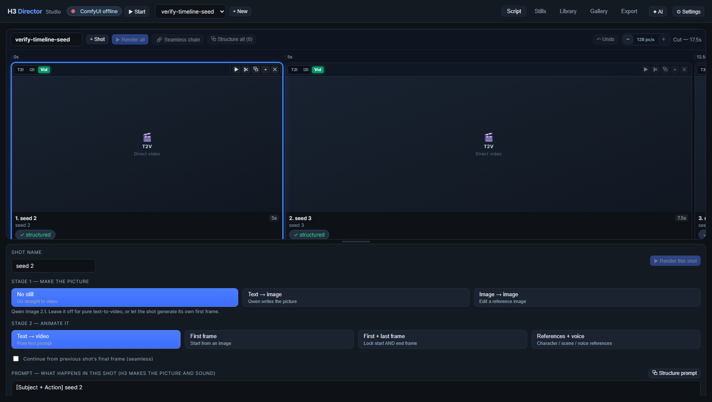

# Workflows

This is the practical guide: how to edit a film in H3 Director rather than how the
internals work.



---

## The Script tab

The **Script** tab is the main editor. The top half is the timeline; the bottom half is
the inspector for the selected shot.

Timeline controls:

| Action | Result |
| --- | --- |
| `+ Shot` in the toolbar | Append a shot at the end |
| `+` on a shot tile | Insert a shot at that position |
| Shift-click tiles | Select a contiguous range; batch bar offers chain, unchain, render N, structure, delete N |
| Drag a tile edge | Resize duration (clamped to 0.5-15 s) |
| Reorder tiles | Changes shot order; the backend persists the new order |
| `Ctrl+Z` | Undo the last structural change (reorder, resize, delete, accept, chain) |
| Drag an image from Explorer onto a tile | Attach as first frame, or as a reference on `r2v`; the tile highlights while hovered |

Deleting a shot also deletes its media and asks first. Edits save about half a second
after you stop typing; rendering and exporting flush pending edits automatically.

---

## Shot modes

| Mode | Name | Use it when | Needs |
| --- | --- | --- | --- |
| `t2v` | Text to video | You want H3 to invent the whole frame | Text prompt |
| `i2v` | First frame | You have a start image and want it animated | One image, often a Qwen still |
| `fl2v` | First + last frame | You need a specific ending pose or composition | Start and end images |
| `r2v` | References + voice | You need a recurring character, location or cloned voice | At least one image/video reference; audio requires a visual reference too |

H3 generates picture **and** sound in one pass. Write sound into the prompt when it
matters: footsteps, crowd murmur, dialogue, music mood. For dialogue, write the line
with the speaker, for example:

```text
Maria says: "We are already too late," her voice tight with restrained panic.
```

An audio-only reference is rejected by H3. If you attach a voice clip, also attach an
image of the speaker.

---

## The two-stage still workflow

Every shot has a **Stage 1 - make the picture** section:

| Still mode | Behaviour |
| --- | --- |
| **No still** | Skip stage 1; go straight to video from the text prompt |
| **Text -> image** | Qwen Image 2.1 writes the picture. Empty still prompt means "reuse the shot prompt" |
| **Image -> image** | Qwen edits one or more Library references; the prompt describes the *change*. Canvas is disabled because the output follows the reference shape |

Useful controls: steps, CFG, sampler/scheduler, seed mode (`random` or `fixed`),
canvas, prompt enhancer, KV-cache device/dtype and **variants** (1-4 per run).

- **Render still** runs only stage 1. It appends takes, promotes the best one to the
  Library and sets it as the shot's first frame, flipping `t2v` to `i2v`.
- **Render still shot** / normal **Render** runs both stages. The still made in that
  run becomes the real first frame.
- Click any still take to swap which one the shot animates.
- Fixed seed plus prompt-only changes gives clean A/B comparisons.

The separate **Stills** tab is a scratchpad for images that are not attached to shots -
useful for look development. It does not feed the pipeline automatically. Promote a
still to the Library and attach it under `i2i` if you want to use it.

---

## Seamless chaining

H3 cannot render more than 15 seconds in one pass, so a long film is several shots.
To make them cut together:

1. Build the shots in order.
2. Render shot 1, open it in **Gallery** and **accept** the take you like.
3. On shot 2, tick **Continue from previous shot's final frame (seamless)**.
4. Render shot 2. The backend extracts the exact last frame of shot 1, writes it as
   frame 0, then morphs into H3's generated motion with optical flow.
5. Repeat down the timeline, or use **Seamless chain** on a selected range.

Why this is not just a prompt trick is explained in
[docs/ARCHITECTURE.md](ARCHITECTURE.md#why-seams-need-ffmpeg). The short version: H3
regenerates keyframes from context, so the last frame is only *similar* unless the app
writes the real frame and morphs into the generated motion in post. The morph is
motion-compensated, so there is no frozen still and no doubled silhouette.

If a shot has a freshly generated Qwen still, "continue from previous" is ignored for
that shot on purpose - otherwise the picture you just made would be replaced.

---

## Keeping the same character across shots

A seamless cut still allows H3 to re-imagine the face — especially after a head turn or
a change to a close-up. Bind a source portrait so both stages receive identity conditioning:

1. Put a clear, front-facing portrait in the **Library** and set its role to `character`.
2. In **Library**, pick it under **Project character** and press **Apply to all** to bind
   it to every existing shot and still board. New shots inherit it automatically.
   For a single character in one scene, use **Source character — identity lock** in that
   shot's inspector instead.
3. Keep **Continue from previous shot's final frame (seamless)** enabled. The seam frame
   does not replace the character reference: it becomes `<Picture 2>` after the portrait.
4. In the **Stills** tab, set the same portrait under **Character lock** on each board if
   you generate stills there.

Attaching a character changes Stage 2 to `r2v`, because MiniMax H3 Easy image mode has
space for only two keyframes. The first/last frames you already chose are not lost: they
are carried as additional picture references. Any `<Picture N>` tags already in your
prompt are shifted by the number of images prepended, so they keep pointing at the same
files. The app shows a 🔒 badge on timeline tiles that have a lock.

If the face still drifts, try a tighter, better-lit source portrait and add an explicit
visual description in the prompt. Identity conditioning is strong but not deterministic.

---

## Library and references

The **Library** tab holds characters, locations, motion clips and voices.

- Upload files or import them from disk.
- Set a **role** (`character`, `voice`, `location`, `motion`, `style`, `prop`, `other`)
  and tags so both you and the AI co-director can find them. Assets with the
  `character` role sort to the top of the character pickers.
- **Project character** chooses the cast inherited by new shots and boards. **Apply to
  all** binds it to the shots and boards that already exist.
- On an `r2v` shot, use the reference panels to attach up to **9 images, 3 videos and
  3 audio** files. With continuity enabled, the seam frame is `<Picture 1>` and the
  portrait locked as the source character is `<Picture 2>` (identity only); otherwise
  the portrait is `<Picture 1>`. These are the *other* references and are numbered after
  them. With a chained seam, the engine also locks the location and camera for the whole
  shot in the compiled prompt and attaches the previous shot's **tail clip** as a
  `<Video N>` reference; one of your three video slots is reserved for it. The full clip
  is deliberately not used because its opening frame can be the source portrait. Avoid "camera follows",
  "zoom" or "cut" in the shot prompt, or H3 will overwrite the location lock with a
  newly generated scene. The `+` button either
  attaches the selected Library item or opens a file picker when nothing is selected.
- You can also drag files from Explorer directly onto a shot tile.

Files are staged into ComfyUI with content-hashed names, so adding the same reference
twice costs nothing and cannot overwrite another project's media.

---

## Gallery, takes and export

Every render appends a **take**. A take stores:

- the resulting video and thumbnail;
- seed, duration, fps and resolution;
- the exact compiled prompt that was sent to H3;
- warnings and errors from the job log.

Accept the best take per shot. Failed takes cannot be accepted - they have no file to
play or export. Export concatenates the accepted take of each shot in timeline order
into `data/exports/` using ffmpeg: 24 fps, H.264 video, AAC audio, `+faststart`.

If a render fails, inspect `data/outputs/<project>/<shot>/graph_<promptId>.json` and
`data/logs/<jobId>.jsonl`. Together they show exactly what was submitted and what the
engine reported.

---

## AI co-director

The **+ AI** tab turns a brief into a shot list. Type a logline, optionally add context,
then generate. The model returns JSON with one object per shot:

```json
{
  "name": "Courtyard, night",
  "kind": "r2v",
  "prompt": "Maria crosses the rain-slick courtyard...",
  "seconds": 6,
  "usesAssets": ["maria-sheet.png"],
  "note": "Carry the over-shoulder framing from shot 2"
}
```

The app matches `usesAssets` against your Library names and attaches them. It will not
invent asset names. Provider setup is in
[docs/INSTALLATION.md#optional---ai-co-director](INSTALLATION.md#optional---ai-co-director).

Prompt-writing rules baked into the co-director system prompt are also good rules for
manual writing:

- State subject, action and environment. Do not re-describe a reference image; say
  "the person from the reference" and add only **new** detail.
- Use camera language: shot size, lens feel and movement with a feel word - slow
  push-in, handheld tracking, fast whip pan.
- Keep dialogue short and natural, with speaker and emotion.
- Mention lighting, palette or time of day only when they change the meaning.
- For continuity, describe what carries over: pose, framing, location, character
  position.

---

## A 60-second film recipe

1. Write six shots of about 8-10 seconds each - below the 15 s H3 ceiling.
2. Upload a character sheet and tag it `character`; upload a voice clip and tag it
   `voice`.
3. For each shot, choose `t2i` as the still mode and a matching video mode.
4. Render stills first (one or two variants) and pick the best. This is cheap compared
   with re-rendering video.
5. Enable **Continue from previous** on shots 2-6.
6. Render all, accept one take per shot, then export.

For drafts, use lower resolution and fewer steps; re-render finals with the same seeds
once the edit is locked.
